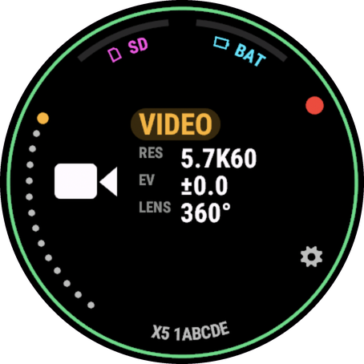
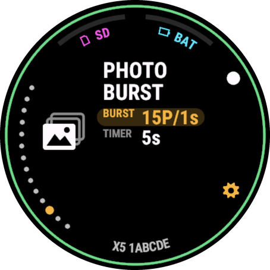
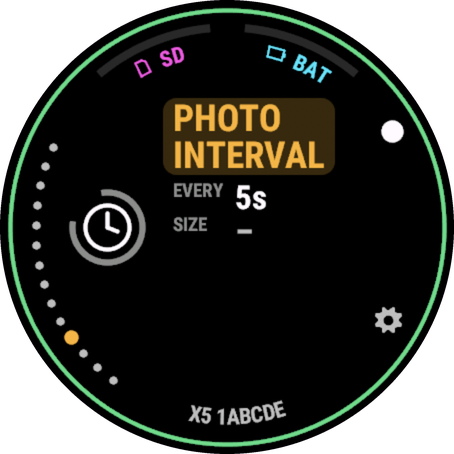
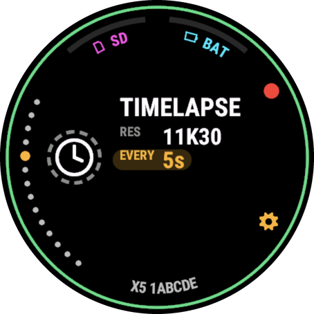
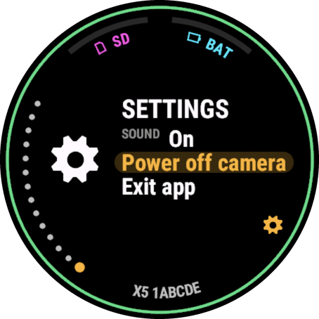
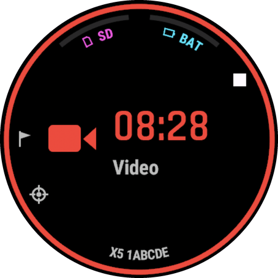
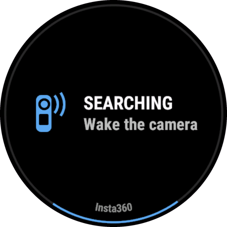
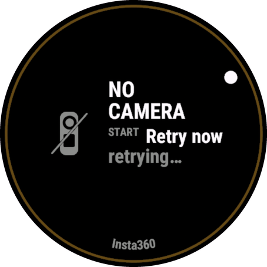

# Insta360 Remote+ for Garmin (Insta360 X5)

Experimental Connect IQ watch app that remote-controls an **Insta360 X5** from a **Garmin Descent
Mk3i** over Bluetooth: pick the mode, change the main shooting settings, start / stop recording,
take photos, mute the camera and power it off. Fork of
[arsfabula/Insta360-Remote-CIQ](https://github.com/arsfabula/Insta360-Remote-CIQ), extended for the
X5 and with a new watch UI.

> **Experimental.** This is an independent, experimental app. It is **not affiliated with, endorsed
> by, or supported by Insta360 or Garmin**. It speaks the camera's unofficial Bluetooth protocol, which
> Insta360 can change with any firmware update — when that happens, parts of the app stop working.
>
> **Nothing leaves the watch.** The app talks only to the camera over Bluetooth. No account, no
> server, no tracking; it does not use the phone or the internet.
>
> **No warranty.** Provided "as is" under the [Mozilla Public License 2.0](LICENSE), without
> warranty of any kind. Check on the camera that it is really recording before you rely on it —
> especially underwater.

## Screenshots

From the Connect IQ simulator demo (made-up camera name, no camera connected). The top arcs show what a real X5 reports: card state and power source, no percentages.

| | | | |
|:---:|:---:|:---:|:---:|
|  |  |  |  |
| Video | Photo Burst, row focused | Photo Interval | Timelapse |
|  |  |  |  |
| Settings page | Recording | Searching | Camera not found |

## Maintenance — please read

This is a personal one-off I built to solve my own problem: the official Insta360 Connect IQ app
crashes on my Descent Mk3i at "Searching for device", and I wanted to control my X5 from the watch
while diving and riding. I'm sharing it in case it helps someone else, and you are welcome to use it
and serve yourself. **I will probably not follow up on it, and I will not troubleshoot setups that
don't work for you.** The code comes as it is. Forks are welcome — the protocol notes below are the
most reusable part.

## Known to work with (verified 11.11.2026)

| Part | Version |
|---|---|
| Watch | **Garmin Descent Mk3i 51 mm** (only device tested; other round Connect IQ ≥ 3.1 watches may work) |
| Camera | **Insta360 X5, firmware v1.13.21** (other X-series cameras use a different protocol generation) |
| Connect IQ SDK | 9.3.0 |

## Install

There is no store release. Build and sideload it yourself:

```bash
monkeyc -f monkey.jungle -d descentmk351mm -y <your developer_key.der> -o bin/remote.prg
```

Connect the watch over USB and copy `bin/remote.prg` to `GARMIN/Apps/` (MTP; on macOS use OpenMTP
or similar). Unplug the watch; the app appears in the apps list.

Before the first use, close the Insta360 phone app (the X5 accepts only **one** Bluetooth client at a
time) and wake the camera. On the first connection the camera may ask you to allow the remote on its
screen.

## How to use it

### The screen

```
          SD card state           battery (charging / on battery)
       ╭───────────────────────────────────────────╮
     •                     VIDEO                 ●  ← START cue
     •   mode           RES   5.7K60
  UP •   icon           EV    ±0.0
     •                  LENS  360°
DOWN •                                          ⚙  ← BACK cue (amber while a setting is focused)
       ╰──────────── X5 1ABCDE ────────────────────╯
 mode dots (amber = current)        camera name and serial suffix
```

* **Outer ring:** green when connected and ready; red and pulsing while recording; a rotating amber
  arc while the camera confirms a start / stop; amber when it does not answer; dim amber when no camera
  is found; a blue arc while searching or connecting.
* **START cue** (top right): red = record, white = photo. While recording it is a white square
  (stop). The Settings page has none.
* **Mode dots** (left edge): one dot per mode, the current one amber. The last dot is the
  **Settings** page.
* **Right column:** the mode name, then the settings of this mode. A value is white once the camera
  confirmed it, grey while it is being sent, and `–` until you set it from the watch (the watch cannot
  read the camera's current values, see *Limitations*).
* **Top arcs:** what the X5 can report over Connect IQ — the SD card state (`SD`, or `NO SD` /
  `FULL` / `SD ERR` in red) on the left, and the power source (`USB` while charging, `BAT` on
  battery, `LOW` in red at the low-battery alarm) on the right. There is no battery percentage, free
  space or remaining time: the camera sends them in replies the watch cannot read (see
  *Limitations*). Older cameras that do report a level show it as a number.
* **Toasts** (short messages in a red pill at the bottom, over the camera name, for 3 s): connected /
  link lost / no response, charging / on battery, low battery, card full / missing / error / OK,
  photo taken, setting rejected, highlight added, *Track That*, camera powering off, and "Allow on
  camera" when the camera asks to allow the remote. A toast never blocks the buttons: a press while
  it is shown acts at once.

### Buttons (Descent Mk3i)

| Button | Ready | Recording |
|---|---|---|
| **START** (top right) | Shoot: start video, take the photo, start the interval / burst / timelapse | Stop |
| **UP** (middle left) | Change the focused row: previous mode, or previous value of the focused setting | Add a highlight |
| **DOWN** (bottom left) | Change the focused row: next mode, or next value | *Track That* |
| **BACK** (bottom right) | Move the focus: mode → setting 1 → setting 2 → … → mode | Not used by the app: the watch may close the app; the camera keeps recording |
| **Hold UP** (menu) | Mode list to jump to a mode, **Exit app** (also while searching) | — |

While searching or when no camera is found, BACK is not used by the app either (the watch closes it).
START retries the search when no camera is found, and resets a start / stop the camera never
confirmed.

The focused row has an amber pill. Modes change on the watch at once and are sent to the camera
when you stop pressing (about 0.8 s), so you can scroll through several modes quickly. A setting is
sent the same way, about 0.8 s after the last press. Value lists wrap around at both ends, except
EV, which stops at −4.0 and +4.0.

Long-press BACK belongs to the watch's operating system, so it does not exit the app.

### Touch

| Gesture | Does |
|---|---|
| **Tap a row** (mode name or a setting) | Focus that row (same as cycling with BACK) |
| **Tap and hold a row** | Focus that row |
| **Swipe up** | Same as DOWN: next mode / next value |
| **Swipe down** | Same as UP: previous mode / previous value |
| **Tap the focused Power off / Exit row again** | Run it (same as START) |
| **Tap anywhere else** | Same as START — **shoots** (or stops a recording). On the Settings page it runs the focused Power off / Exit row and never shoots. |

Touch can be turned off in the watch's own settings; the buttons do everything.

### Settings per mode

| Mode | Settings on the watch |
|---|---|
| Video | Resolution / frame rate (8K, 5.7K+, 5.7K, 4K at every rate the camera accepts), EV, lens (360° / front) |
| PureVideo | Resolution / frame rate (8K, 5.7K, 4K at 30 / 25 / 24) |
| Timelapse | Resolution (11K, 8K, 5.7K at 30), interval (0.5 s – 120 s) |
| TimeShift | Resolution (8K / 5.7K), speed (Auto, 10× – 60×) |
| Bullet Time | Resolution (5.7K120 / 3K240) |
| Loop Rec | Resolution / frame rate, loop length (1 – 30 min, ∞), lens |
| Road Mode | Resolution / frame rate |
| Photo | Self-timer, size (72 MP / 18 MP), EV, lens |
| Photo Interval | Interval (3 s – 120 s), size |
| Photo Burst | Shots / seconds (3P/1s … 15P/10s), self-timer |
| Starlapse | Duration (∞, 3 min – 10 h), self-timer |
| Gimbal, Star Video | Mode only |

### Settings page (last mode dot, gear icon)

| Row | Does |
|---|---|
| **SOUND** On / Off | Mutes / unmutes the camera |
| **Power off camera** | Asks *"Power off camera?"* with two choices, **No** (focused) and **Yes, power off**; only *Yes* switches the camera off, so pressing START twice keeps it on. Turning it on again is done on the camera (see *Limitations*). |
| **Exit app** | Closes the app |

Focus a row with BACK (or a tap) and press START. While the Settings page is shown, the camera keeps
its mode; UP / DOWN on the mode row goes back to the camera modes.

### Exiting the app

Settings page → **Exit app**, or hold UP → **Exit app**, or BACK in a mode that has no settings
(or while no camera is connected).

## Limitations

These come from the camera or from Connect IQ, not from missing work. Details and evidence are in
[`docs/x5-protocol.md`](docs/x5-protocol.md).

* **The watch cannot read the camera's settings.** Connect IQ delivers at most 20 bytes per
  Bluetooth notification and never more, and every X5 reply that carries a current value is longer.
  So the watch shows `–` until you set a value, it shows charging / on battery but not the battery
  percentage, and the card's state but not its free space or remaining time.
* **GPS overlay is for the older (pre-X5) cameras only.** It sends the watch's position with the
  legacy photo command. The X5 path does not use it, so with an X5 the menu item is hidden and the
  watch's GPS stays off.
* **Changes made on the camera itself are not reported** to the watch (except the mode), and a
  setting sent while the camera's own menu is open is ignored.
* **One Bluetooth client at a time.** Close the Insta360 phone app (or anything else connected to
  the camera) first.
* **No power-on from the watch.** The camera can be woken from off by a Bluetooth *wake beacon*
  (it works from a Mac, `tools/wake.swift`), but Connect IQ apps can only connect to devices — they
  cannot send advertisements. Garmin has an open feature request for it, unanswered.
* **No indicator light, beep or screen-lock control.** The X5 firmware does not expose them over
  Bluetooth (tested: switching them on the camera changes none of its readable settings, and the
  matching protocol options are accepted but not stored). Only mute works.
* **Not settable:** 5.7K at 48 fps, HDR / Active HDR and other image options; Gimbal and Star Video
  have no settings on the watch yet.
* **The watch's LIGHT button** is not used: the watch most likely keeps it for itself (the current
  build logs which keys reach the app, to confirm).
* **Known issue:** after the camera goes to standby by itself, the app can keep trying to reconnect
  even when the camera is awake again. Restarting the app fixes it.
* Tested only on one watch and one camera firmware. Anything else is a guess.

## The documentation we dug up

Most of the work in this repository is protocol research: what the X5 actually accepts over
Bluetooth, tested command by command on a real camera and checked on its own screen (through a
webcam).

* [`docs/x5-protocol.md`](docs/x5-protocol.md) — the Insta360 X5 remote-control protocol over BLE
  and Wi-Fi as tested on firmware v1.13.21. It covers:
  * framing and the session;
  * modes;
  * capture;
  * per-mode footage settings with every resolution / frame-rate value, the EV encoding, and the
    interval and timelapse timing;
  * camera status: battery, SD card, mute;
  * notifications;
  * power off, and the **wake beacon** that powers the camera on;
  * what is *not* reachable: LED, beep, lock and child mode;
  * the Connect IQ limits, with their evidence.

  Each command is marked by how it was verified.
* [`docs/watch-app.md`](docs/watch-app.md) — how the watch app maps onto the protocol (feature →
  protocol section → code), and confirmed features that are ready to add.
* [`docs/tools.md`](docs/tools.md) — Mac tools to reproduce everything: one long-lived BLE session,
  command survey, settings sweeps, the wake beacon, Wi-Fi and watch-log helpers.
* [`docs/data/`](docs/data/) — the full command / option survey and the camera's own mode catalog
  for firmware v1.13.21. Results from other cameras or firmware are welcome.

## Credits

* [ArsFabula](https://github.com/arsfabula/Insta360-Remote-CIQ) — the original Insta360 Remote
  Connect IQ app this is forked from.
* [pchwalek/insta360_ble_esp32](https://github.com/pchwalek/insta360_ble_esp32) — the wake-beacon
  format (found on the X3 / ONE RS), confirmed here on the X5.
* The community-recovered `insta360.messages` protobuf definitions, used for message and field names.
  No Insta360 firmware or app code was decompiled for this work.

## License

[Mozilla Public License 2.0](LICENSE), the license of the upstream app. It is not MIT because this
is a fork: MPL-2.0 requires modified upstream files to stay under MPL-2.0. In practice it is close:
you may use, change and share this code, including in other projects; only changes to these files
must be shared under the same license. Provided "as is", without warranty.

Insta360 and Garmin are trademarks of their respective owners.
